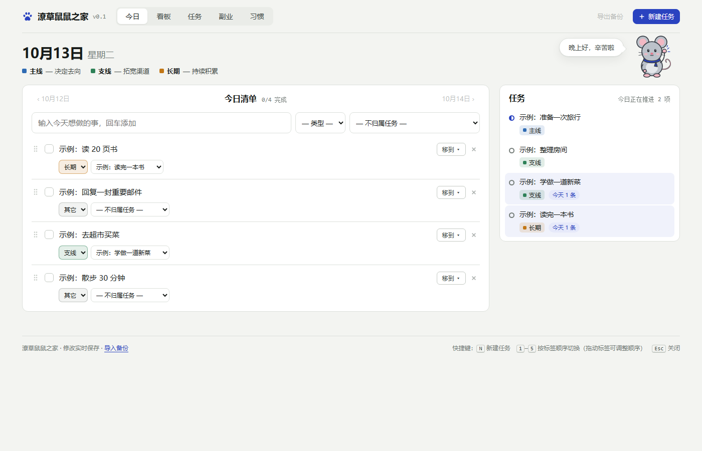
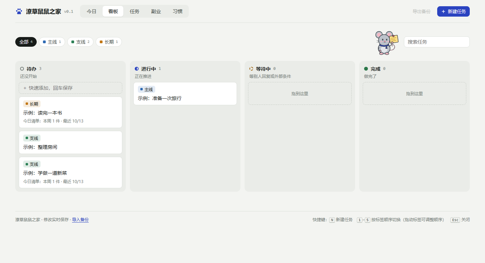
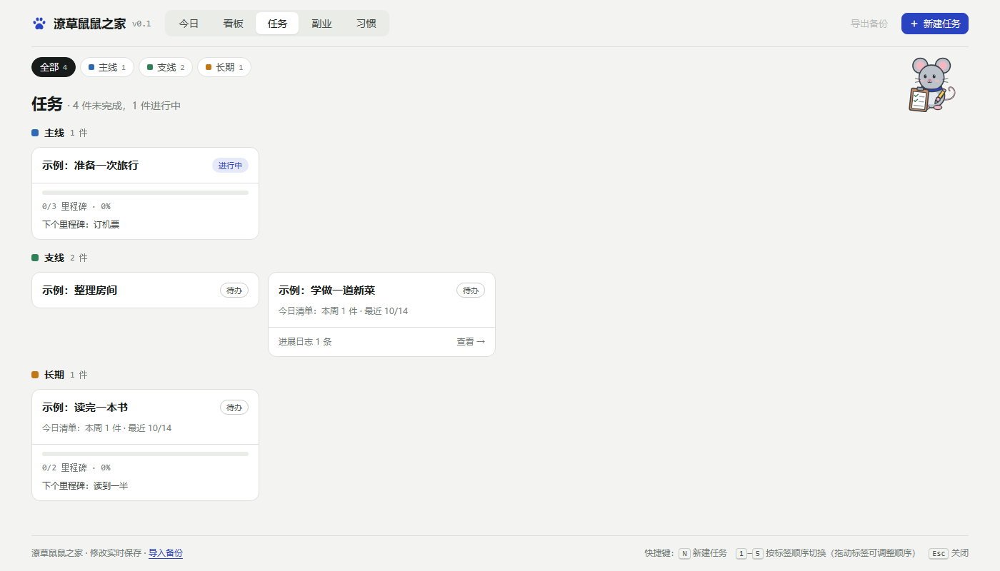
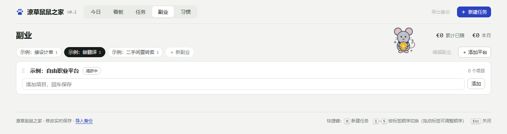
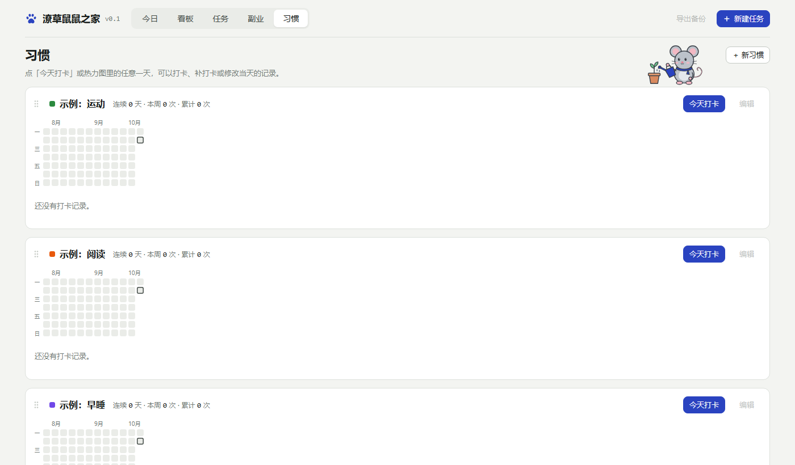

# Weisy · daily desk

**English** · [中文](README.md)

Weisy (Chinese name: 潦草鼠鼠之家) is a small personal workbench that runs entirely on your own computer: a today list, a task board,
milestones with an automatic progress log, side-project tracking and habit check-ins — with a little mouse
keeping you company. No account, no cloud, no tracking: your data is one JSON file on your disk.

> The interface is currently in Chinese. An English / Chinese switch is planned for the next version.



## What's inside

| Page | What it does |
|---|---|
| 今日 Today | A list for the day. Give each item a type (main / side / long-term / other) and the task it belongs to — Weisy suggests the task while you type. Finished items stay on their day; the mouse cheers when you tick one off. |
| 看板 Board | Drag tasks between To do / Doing / Waiting / Done. |
| 任务 Tasks | Every task grouped by type. Open one to see its next step, notes, milestones and a progress log that is built automatically from the today-list items linked to it. |
| 副业 Side projects | Track side projects, the platforms you use and what each one earned. |
| 习惯 Habits | One-tap check-ins with a year heatmap, optional tags, minutes and notes. |






## Quick start

### Windows

1. Install [Python 3](https://www.python.org/downloads/) (tick "Add python.exe to PATH" during setup).
2. Download this repository (Code → Download ZIP) and unzip it wherever you like.
3. Double-click **`start.bat`**. Weisy opens in its own window.

The first time, a small dialog asks you two things (**once you choose, you will not be asked again, so decide carefully**):
- **Where to keep your data.** If unsure, keep the default; to use your D: drive, click *更改…* (Change…) and pick a
  folder (not one inside the program folder).
- **Whether to put an icon on your desktop.**

Not sure yet? Just close the small window (×): Weisy quits without creating anything and asks again next time.

### macOS

1. Install [Python 3](https://www.python.org/downloads/) if `python3` is not available yet.
2. Download this repository (Code → Download ZIP) and unzip it anywhere.
3. Double-click **`start.command`**. The first time, macOS may refuse: right-click it, choose *Open*, and confirm.
   If it says the file cannot be run, run `chmod +x start.command` once in Terminal.
   Weisy opens in your default browser. (Not yet tested on a real Mac — please open an issue if something is off.)

### Linux

Run `sh start.command`, or `python3 tools/build.py` once, then `python3 server.py` and open <http://127.0.0.1:8780/>.

macOS / Linux have no dialog: the data goes to the default place (`~/.weisy-data/`). To use another folder, start
with `python3 server.py --data <folder>`.

### Closing

Just close the Weisy window (or browser tab). A few seconds later the program stops by itself — there is nothing
running in the background. To keep it running anyway, start `python3 server.py --keep-alive`.

Optional: in Edge or Chrome choose *Install this site as an app* to get a taskbar icon.
Opening Weisy again brings the existing window to the front.

### Updating (keeping your data)

1. Close Weisy.
2. **Note where your data is:** open `.weisy\location.txt` in the program folder with Notepad — the line in it is the
   path. If there is no such file, you are using the default place.
3. Delete the old program folder (your data is not inside it).
4. Download the new version, unzip it and double-click `start.bat`.
5. In the small dialog: if you used the default place, just click the start button; otherwise click *更改…* and pick
   your old data folder again.

Your old data is picked up automatically: new version, old data.

## Your data

- Everything is saved in `weisy.json` as you type, in a folder **outside** the program folder. Default place:
  `C:\Users\<you>\AppData\Roaming\Weisy-Data\` on Windows, `~/.weisy-data/` on macOS and Linux.
  If you chose another place in the first-run dialog, the data is in a `Weisy-Data` folder inside the one you picked,
  and the default place is never created.
- The first run puts in three task types and a few examples (titled 「示例：…」, i.e. "Example: …") — delete them
  whenever you like.
- Weisy's own two small notes (the data place you chose, and that you were asked) live in `.weisy` inside the program
  folder, so nothing is scattered around your computer.
- **Changing the folder later:** close Weisy, move the data folder to its new place, then edit the path in
  `.weisy\location.txt` with Notepad.
- **If the data folder cannot be found** (for example an unplugged drive), Weisy says so and refuses to start — it never
  quietly creates an empty set of data. Reconnect the drive and start again; to give up that place and start fresh,
  delete `.weisy\location.txt`.
- Before the first change of each day a copy goes to the `backups` folder inside the data folder (the last 30 days are kept).
- The page also has **导出备份** (export) and **导入备份** (import) for a JSON backup.
- The server only listens on `127.0.0.1` and refuses requests from other websites.
- To remove Weisy completely, delete the program folder, the desktop icon and the data folder — that is everything.
- (Developers: a `data/weisy.json` next to `server.py` is used first if it exists.)

## For developers

```
server.py              local server (Python standard library only)
starter.json           data for the very first run (three task types)
start.bat              Windows launcher
start.command          macOS launcher (also works on Linux)
src/workbench.html     the page (HTML, CSS, JavaScript in one file)
src/local-store.js     data layer talking to server.py
src/vendor/            Sortable.js 1.15.2 (MIT) for drag and drop
src/assets/            icons and the mascot drawings (SVG)
tools/build.py         builds app/index.html from src/
tools/setup.ps1        first-run dialog on Windows (data folder, desktop shortcut)
tools/make_icons.py    regenerates the icons (needs Pillow)
tests/                 end-to-end tests with fictional sample data
```

- Build: `python tools/build.py` (writes `app/`, which is not committed).
- Test: `python tests/test_local.py` — starts the server on port 8799 with `tests/sample-data.json`,
  runs `tests/test.js` in headless Microsoft Edge and checks the saved data. Set `EDGE_PATH` if Edge
  is installed somewhere unusual.

## License

[MIT](LICENSE). The mouse drawings in `src/assets/mascots` are original artwork made for this project
and are covered by the same license.
